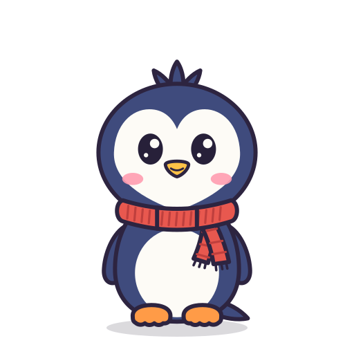

# Penguin desktop pet — animation pack

A chibi penguin (navy back, heart-shaped white face, red knitted scarf) with 37 animated reactions.
Every clip ships twice with identical motion:

- `lottie/<clip>.json` — Lottie / bodymovin **5.7** (`"v":"5.7.0"`), shape + null layers only, no images, masks, gradients or text layers.
- `svg/<clip>.svg` — self-contained animated SVG using **SMIL** (`<animateTransform>` / `<animate>`), no scripts, no CSS animation.

All clips: **512×512**, **30 fps**, fully transparent background. Base pose stands with the feet on the ground at y≈470 at 80% scale.

## Files

| Path | What it is |
|---|---|
| `lottie/` | 37 Lottie JSON files |
| `svg/` | 37 animated SVG files |
| `index.json` | clip list: `name`, `category`, `frames`, `seconds`, `loop` (plus file paths, `holds_pose`, `note`, `default`) |
| `preview.html` | plays every clip on a checkerboard; switch between SVG, Lottie, or both side by side. Works offline. |
| `cursor_demo.html` | full-window cursor-follow demo driven by the `int_look_*` clips, with poke, drag, walk, slide and idle/sleep behaviour. Works offline. |
| `checks/` | key-frame render comparison of both formats (contact sheets: top row Lottie, bottom row SVG) and `report.json` |
| `src/` | the generator (Python): rig, clips, exporters. `python3 src/build.py out_dir` rebuilds everything. |

## Clips

| Clip | Category | Frames | Seconds | Playback |
|---|---|---|---|---|
| `idle_breathe` | idle | 120 | 4.0 | loop |
| `idle_look_left_right` | idle | 120 | 4.0 | loop |
| `idle_yawn` | idle | 120 | 4.0 | loop |
| `idle_stretch` | idle | 120 | 4.0 | loop |
| `idle_groom` | idle | 150 | 5.0 | loop |
| `idle_flap` | idle | 120 | 4.0 | loop |
| `sleep_fall_asleep` | sleep | 90 | 3.0 | plays once |
| `sleep_loop` | sleep | 120 | 4.0 | holds pose (loop) |
| `sleep_wake_up` | sleep | 100 | 3.333 | plays once |
| `move_walk` | movement | 40 | 1.333 | loop |
| `move_hop` | movement | 50 | 1.667 | loop |
| `move_belly_slide` | movement | 90 | 3.0 | loop |
| `move_fall_land` | movement | 75 | 2.5 | plays once |
| `int_dragged` | interaction | 60 | 2.0 | holds pose (loop) |
| `int_petted` | interaction | 90 | 3.0 | loop |
| `int_poked` | interaction | 100 | 3.333 | loop |
| `int_tickled` | interaction | 90 | 3.0 | loop |
| `int_look_up` | interaction | 60 | 2.0 | holds pose (loop) |
| `int_look_up_right` | interaction | 60 | 2.0 | holds pose (loop) |
| `int_look_right` | interaction | 60 | 2.0 | holds pose (loop) |
| `int_look_down_right` | interaction | 60 | 2.0 | holds pose (loop) |
| `int_look_down` | interaction | 60 | 2.0 | holds pose (loop) |
| `int_look_down_left` | interaction | 60 | 2.0 | holds pose (loop) |
| `int_look_left` | interaction | 60 | 2.0 | holds pose (loop) |
| `int_look_up_left` | interaction | 60 | 2.0 | holds pose (loop) |
| `mood_happy` | mood | 120 | 4.0 | loop |
| `mood_sad` | mood | 120 | 4.0 | loop |
| `mood_surprised` | mood | 90 | 3.0 | loop |
| `mood_hungry` | mood | 120 | 4.0 | loop |
| `mood_love` | mood | 120 | 4.0 | loop |
| `mood_cold` | mood | 120 | 4.0 | loop |
| `mood_smile_wink` | mood | 90 | 3.0 | loop |
| `fun_spin` | fun | 90 | 3.0 | loop |
| `fun_peek` | fun | 120 | 4.0 | holds pose (loop) |
| `fun_notify` | fun | 60 | 2.0 | holds pose (loop) |
| `fun_snowball` | fun | 150 | 5.0 | loop |
| `fun_fish_catch` | fun | 120 | 4.0 | loop |

`idle_breathe` is the default loop (`"default": true` in `index.json`).

## Playback rules

- **Loops** (`loop: true`) are seamless and start and end in the base standing pose, so you can cut between them at the loop boundary.
- **Plays once** (`loop: false`) clips end holding their last pose (SVG uses `fill="freeze"`; in Lottie set `loop: false` and the player stops on the last frame).
- **Holds pose** loops are seamless but loop around a held state instead of the base pose, by design:
  - `sleep_loop` — the asleep pose; chain `sleep_fall_asleep` → `sleep_loop` → `sleep_wake_up` (which ends in the base pose).
  - `int_dragged` — dangling by the scarf; pivots at the scarf so it swings naturally while held.
  - `int_look_*` (8 directions) — head and eyes held toward the cursor, with light breathing. Switch between them instantly for cursor following; return to `idle_breathe` when the cursor is near or still.
  - `fun_notify` — standing on the ice floe with the fish flag and "!" badge; loop it while an alert is active.
  - `fun_peek` — starts and ends off-canvas (empty frame) on the right edge.
- `move_walk` and `move_belly_slide` animate **in place**; your app moves the window. The belly slide faces right; mirror the window content (`transform: scaleX(-1)`) to slide left. The walk is symmetric.
- `move_fall_land` begins with the penguin above the canvas (empty frame) and ends sitting up with dizzy stars.

## Rig

Built as separate parts so you can extend it: `root` → `rock` (waddle/wobble pivot at the feet) → `breath` → `body` →
`head` → `face`, plus `flipL/flipR` (shoulder pivots, with back and front variants), `footL/footR`, `tail`, `tuft`,
`scarf` (3 band segments `scarf_L/M/R` and two tails `scarf_tailA/B`), and the ground `shadow`.
Swappable variants: eyes (`open`, `sleepy` ∪, `happy` ^, `squint` > <, `wink`, `heart`, `dizzy`), beak (`smile`, `tongue`,
`o`, `yawn`, `frown`, `squawk`), brows (`worried`, `angry`), cheeks (`pink`, `cold`, `blush`).
Props: fish, snowball, ice floe, pebble. All glyphs (z, ?, !, anger mark) are vector paths, not text.

## Using the files

```js
// Lottie (lottie-web)
lottie.loadAnimation({ container, renderer: 'svg', loop: clip.loop, autoplay: true, path: 'lottie/idle_breathe.json' });
```
```html
<!-- SVG: SMIL plays in , <object> or inline <svg> -->

```
To restart an inline SVG: `svg.setCurrentTime(0)`. To pause: `svg.pauseAnimations()`.

## Verification

Before delivery, 8 key frames of every clip were rendered from both formats in headless Chromium (lottie-web 5.12.2 SVG renderer
vs. native SMIL, paused at the same time) and diffed. The worst frame across all 37 clips differs on 0.66% of pixels,
all of it 1–2 px anti-aliasing along outlines; the largest cases are frames where a part is squashed nearly edge-on (mid-spin, mid-flop).
Loops were also checked programmatically: every track has the same value on its first and last frame, and non-holding loops start in the base pose.
